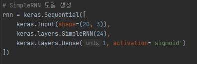
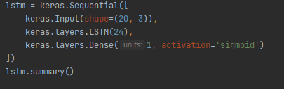
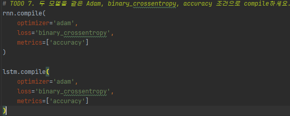
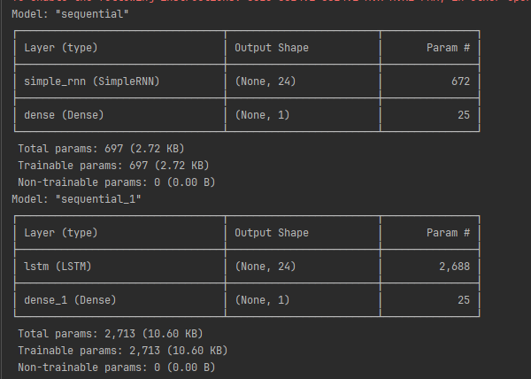
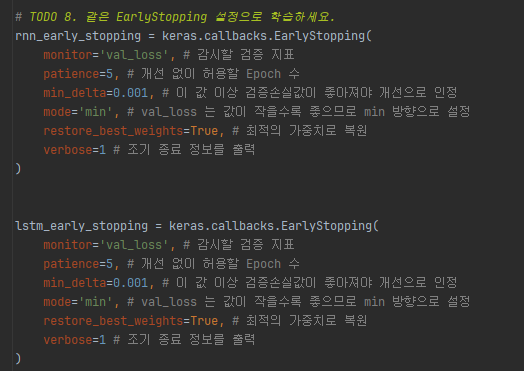
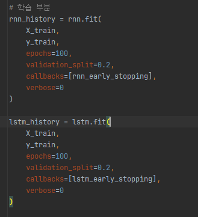
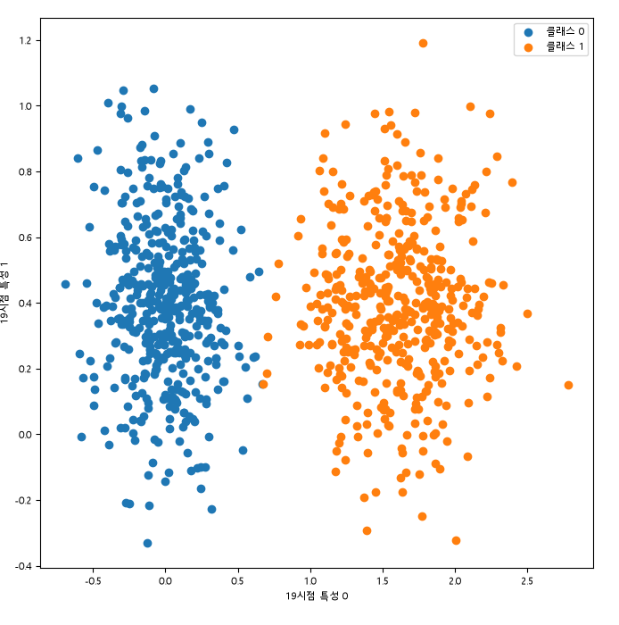

# Team 4 데일리 딥러닝 프로젝트 보고서

## 1. 프로젝트 개요
- 프로젝트명: 센서 이상 징후 판별
- 문제 유형: 이진 분류
- 사용 모델: SimpleRNN / LSTM
- 팀원: 정유아, 신의진
## 역할 분담:
- 정유아: 데이터 전처리 확인, SimpleRNN/LSTM 모델 구현 및 결과 분석 공동 참여 
- 신의진: 데이터 구조 확인,,모델 학습, 시각화 및 결과 분석 공동 참여

## 2. 데이터 구조
- 데이터 파일: `team4_data.npz`
- 입력 X의 shape: `(900, 20, 3)`

- 정답 y의 shape: `(900,)`

- 각 축(axis)의 의미:
  - `samples = 900`: 전체 샘플 수
  - `timesteps = 20`: 한 샘플의 시간 시점 수
  - `features = 3`: 각 시점의 센서 특성 수

즉, 하나의 샘플은 20개의 시점과 각 시점마다 3개의 센서 특성으로 구성되어 있다.

- Target 또는 정답의 의미:
  - `0`: 정상
  - `1`: 이상 징후

클래스 개수는 정상 450개, 이상 450개로 동일하여 클래스 불균형은 없었다. 

### 데이터 기본 확인!

- X와 y의 샘플 개수 일치 여부 확인
- 결측치(NaN) 확인
- 무한대(inf) 이상치 값 확인
- 중복 샘플 확인

## 3. 모델 구조
- Input shape: `(20, 3)`

### SimpleRNN
- `SimpleRNN(24)`
- `Dense(1, activation='sigmoid')`

### LSTM
- `LSTM(24)`
- `Dense(1, activation='sigmoid')`
- 

### 동일한 모델설정값
- 은닉층 Activation: 기본 `tanh`
- 출력층 Activation: `sigmoid`
- Loss Function: `binary_crossentropy`
- Optimizer: `Adam`
- Learning Rate: Adam 기본값 사용
- 전체 파라미터 수:
  - SimpleRNN: `697`
  - LSTM: `2,713`

### 컴파일도 동일하게 설정

### model.summary()에서 확인한 것
- 두 모델 모두 `units=24`와 동일한 출력층을 사용하였다.
- LSTM은 여러 Gate와 Cell State를 사용하기 때문에 SimpleRNN보다 파라미터 수가 약 4배정도 많다.

## 4. 학습 설정
- Epoch: 최대 `100`
- Batch Size: `32` (기본값)
- Validation 방식: `validation_split=0.2`
- Dropout: 사용하지 않음(데이터 크기가 적어 큰모델사용 보단 모델을 작게 만듬
-  그래서 뉴런수 하나 하나가 소중해 dropout을 사용하지 않는게 좋다고 판단함)
- EarlyStopping monitor: `val_loss`
- EarlyStopping patience: `5`
- EarlyStopping min_delta: `0.001`
- EarlyStopping mode: `min`
- restore_best_weights: `True`
- 실제 수행된 Epoch 수:
  - SimpleRNN: `[실제 RNN epoch 횟수: 40]`
  - LSTM: `[실제 LSTM epoch 횟수: 39]`

두 모델에는 동일한 EarlyStopping 조건을 적용하였다.

`val_loss`가 일정 기간 개선되지 않으면 학습을 종료하고, `restore_best_weights=True`를 통해 가장 좋은 시점의 가중치를 복원하였다.

### 학습 방식도 동일하게 하였다

## 5. 학습곡선 분석
학습 곡선은 추후 7 번에서 설명할 예정
### Train Loss / Validation Loss
- 관찰 내용:
  - RNN과 LSTM 모두 학습하면서 validation loss가 감소했고
  - 두 모델 모두 높은 검증 성능을 보였으며 최종 validation accuracy는 두 모델 모두 1.0이 나왔다

- 과적합 여부:
  - validation 성능이 계속 높게 유지되었고 EarlyStopping도 정상적으로 동작해
  - 결과상 뚜렷한 과적합은 보이지 않았다

- EarlyStopping 종료 시점:
  - SimpleRNN: SimpleRNN: 37 Epoch에서 종료, best epoch는 32
  - LSTM: LSTM: 39 Epoch에서 종료, best epoch는 34

### 추가 지표
- SimpleRNN 'val_loss' : 0.00296
- LSTM 'val_loss' : 0.00334
- SimpleRNN 'val_accuracy' : 약 1.0 (1이랑 가까움)
- LSTM 'val_accuracy' : 약 1.0 (1이랑 가까움)
- SimpleRNN 'test accuracy' : 0.956
- LSTM 'test accuracy' : 약 1.0 (1이랑 가까움)

- 관찰 내용:
- validation accuracy는 두 모델 모두 약 1.0가깝게 동일하게 나티났다
- validation loss,test accuracy 모두 LSTM이 SimpleRNN보다 조금 더 높았다
- Test accuracy에서 SimpleRNN은 약99.6% LSTM은 100%로 두 모델 모두 높은 성능을 보였다

## 6. 최종 성능
- 사용한 평가 지표:
  - Accuracy
  - Confusion Matrix
### SimpleRNN
- Accuracy: 약 `99.56%`
- 전체 테스트 데이터: `225개`
- 오분류: `1개`

혼동행렬:
- TN: `112`  정상으로 예측해 맞음 $\rightarrow$ 정상 판정 성공
- FP: `1` 이상으로 예측해 틀림 $\rightarrow$ 오탐 (오경보)
- FN: `0` 정상으로 예측해 틀림 $\rightarrow$ 미탐 (이상 놓침)
- TP: `112` 이상으로 예측해 맞음 $\rightarrow$ 이상 감지 성공

이상 징후 112개는 모두 정확하게 판별하였으며, 정상 데이터 1개를 이상으로 잘못 판단하였다.

### LSTM
- Accuracy: `100%`
- 전체 테스트 데이터: `225개`
- 오분류: `0개`

혼동행렬:
- TN: `113` 정상으로 예측해 맞음 $\rightarrow$ 정상 판정 성공
- FP: `0` 이상으로 예측해 틀림 $\rightarrow$ 오탐 (오경보)
- FN: `0` 정상으로 예측해 틀림 $\rightarrow$ 미탐 (이상 놓침)
- TP: `112` 이상으로 예측해 맞음 $\rightarrow$ 이상 감지 성공

LSTM은 테스트 데이터의 정상과 이상 징후를 모두 정확하게 분류하였다.

### 최종 결과
두 모델 모두 높은 성능을 보였으며, 특히 두 모델 모두 `FN=0`으로 실제 이상 징후를 놓치지 않았다.

## 7. 시각화 결과

### 그래프 1
- 제목: 랜덤으로 한 시점의 특성의 퍼짐
- 그래프: 
- 해석:
  - 0인 정상 과 1인 이상 징후가 를 보인 클래스 별로 데이터 퍼짐을보았을때
  - 섞인게 아니 대체적으로 잘 분리되는걸로 보아 
  - 구분이 쉬워 높은 정확도가 나와도 이상하지 않을 가능성이 있다고 판단

### 그래프 2
- 제목: Simple RNN 학습곡선
- 그래프: 
- 해석:
  - Train Loss와 Validation Loss가 학습 초반에 빠르게 감소하였다.
  - 이후 두 Loss가 완만하게 감소하면서 0에 가까워졌다.
  - Train Loss와 Validation Loss의 차이가 크지 않고 비슷한 흐름을 보였다.

- 과적합 여부:
  - Validation Loss가 다시 증가하는 현상이 나타나지 않았다.
  - Train Loss와 Validation Loss가 비슷하게 감소하므로 뚜렷한 과적합은 나타나지 않은 것으로 판단하였다.

### 그래프 3
- 제목: LSTM 학습 곡선
- 그래프: 
- 해석:
  - Train Loss와 Validation Loss가 함께 지속적으로 감소하였다.
  - 두 손실값의 차이가 크지 않고 Validation Loss가 다시 증가하지 않았다.
  - 후반부에서는 Loss의 감소 폭이 작아지면서 학습이 안정화되었다.

- 과적합 여부:
  - Train Loss와 Validation Loss가 비슷한 흐름을 보여 뚜렷한 과적합은 나타나지 않은 것으로 판단하였다.

## 8. 모델 선택 및 해석
- 최종적으로 선택한 모델/설정: `LSTM(24)`

- 선택 근거:
  - SimpleRNN Accuracy: 약 `99.56%`
  - LSTM Accuracy: `100%`
  - SimpleRNN은 FP가 1개 발생하였고, LSTM은 오분류가 없었다.

- 다른 모델/설정과 비교한 차이:
  - SimpleRNN 파라미터 수: `697`
  - LSTM 파라미터 수: `2,713`

LSTM은 SimpleRNN보다 구조가 복잡하고 파라미터 수가 많지만, 이번 실험에서는 모든 테스트 데이터를 정확하게 분류하였다.

다만 두 모델의 차이는 테스트 샘플 1개이므로 모든 상황에서 LSTM이 더 우수하다고 일반화할 수는 없다.

- 데이터 구조와 이 모델이 잘 맞는 이유:

입력 데이터는 `(samples, 20, 3)` 형태의 순차 데이터이다.

SimpleRNN과 LSTM은 이전 시점의 정보를 활용하여 시간에 따른 센서 변화 패턴을 학습할 수 있기 때문에 이번 데이터 구조에 적합하다고 판단 하였다

## 9. 한계와 개선 아이디어
- 현재 데이터/모델의 한계:
  - 전체 데이터가 900개로 많지 않다.
  - 실제 환경에서는 정상 데이터보다 이상 데이터가 훨씬 적을 수 있다.
  - 현재 데이터는 정상과 이상이 비교적 잘 구분되는 패턴을 가지고 있다.
  - 정상과 이상 두 클래스만 판별한다.

- 추가로 시도해 볼 설정:
  - units 변경
  - Learning Rate 변경
  - Dropout 적용
  - Batch Size 변경
  - timesteps 변경
  - 더 많은 센서 특성과 데이터 사용

- 실제 업무에 적용하려면 필요한 데이터:
  - 다양한 정상 상태 데이터
  - 실제 고장 및 고장 직전 데이터
  - 여러 종류의 이상 징후 데이터
  - 다양한 장비의 장기간 센서 데이터
  - 센서 오작동과 환경 변화가 포함된 데이터

## 10. 최종 결론

본 프로젝트에서는 20개의 시점과 각 시점마다 3개의 센서 특성을 가진 데이터를 이용하여 정상과 이상 징후를 분류하였다.

입력 데이터의 shape는 `(samples, 20, 3)`이며, 시간에 따른 패턴을 학습하기 위해 SimpleRNN과 LSTM을 사용하였다.

두 모델 모두 24개의 units와 동일한 출력층 및 학습 조건을 사용하였다.

학습 과정에서는 `val_loss`를 기준으로 EarlyStopping을 적용하여 불필요한 학습과 과적합을 줄이고자 하였다.

평가 결과 SimpleRNN은 약 99.56%, LSTM은 100%의 정확도를 기록하였으며 두 모델 모두 이상 징후를 놓치지 않았다.

다만 현재 데이터는 정상과 이상이 비교적 잘 구분되므로 실제 적용을 위해서는 더 다양한 실제 센서 데이터를 이용한 검증이 필요하다.

