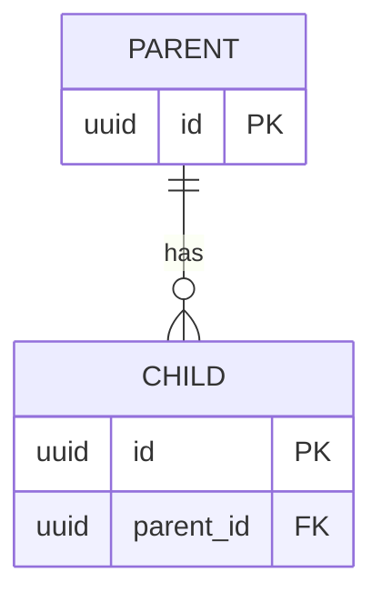

# 데이터베이스 설계서

## 1. ERD

> 위 ERD는 예시입니다. 실제 테이블명·관계를 수정하세요.

## 2. 테이블 정의
| 테이블 | 컬럼 | PostgreSQL 타입 | PK/FK/UNIQUE | NULL 허용 | 설명 |
|---|---|---|---|---|---|
| [ ] | id | UUID | PK | N | 고유 ID |
| [ ] | created_at | TIMESTAMPTZ | | N | 생성 시각 |

## 3. SQL 구현
- 스키마 파일: `sql/schema.sql`
- 초기 데이터: `sql/seed.sql` (필요 시)
- 쿼리 파라미터 바인딩 적용: [ ]

## 4. CRUD 및 테스트
| 동작 | SQL 또는 함수 | 기대 결과 | 실제 결과 |
|---|---|---|---|
| Create | [ ] | 1건 삽입 | [ ] |
| Read | [ ] | 조회 성공 | [ ] |
| Update | [ ] | 수정 성공 | [ ] |
| Delete | [ ] | 삭제 성공 | [ ] |

## 5. 개인정보 보관·삭제 정책
[ ]
