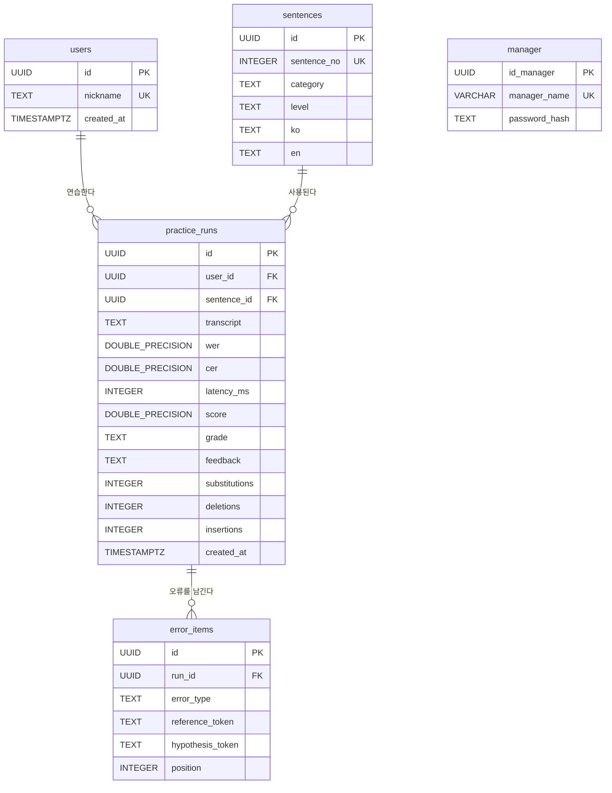

# 데이터베이스 설계서

> 기준: SQL·Python·Streamlit 코드(2026-10-28). 학습 테이블 4개는 생성 SQL로 확인되며, 별도 관리자 테이블은 로그인 SQL의 참조와 팀에서 공유한 구조를 바탕으로 작성

## 1. ERD

## 2. 테이블 정의

| 테이블 | 컬럼 | PostgreSQL 타입 | PK/FK/UNIQUE | NULL 허용 | 설명                                               |
|---|---|---|---|---|----------------------------------------------------|
| `users` | `id` | UUID | PK | N | 내부 회원 ID; 기본값 `gen_random_uuid()`           |
| `users` | `nickname` | TEXT | `LOWER(nickname)` 고유 인덱스 | N | 화면 닉네임; 공백만 입력 금지                      |
| `users` | `created_at` | TIMESTAMPTZ | — | N | 등록 시각; 기본값 `now()`                          |
| `sentences` | `id` | UUID | PK | N | 문장 ID; 연습 FK 대상                              |
| `sentences` | `sentence_no` | INTEGER | UNIQUE | N | 화면 번호; 양수만 허용, 기본 시드 1~34             |
| `sentences` | `category` | TEXT | — | N | 기본 5개 카테고리 중 하나. DB CHECK는 없음         |
| `sentences` | `level` | TEXT | CHECK | N | `쉬움`·`보통`·`어려움`                             |
| `sentences` | `ko` | TEXT | — | N | 한국어 정답 문장                                   |
| `sentences` | `en` | TEXT | — | N | 영어 번역                                          |
| `practice_runs` | `id` | UUID | PK | N | 저장된 연습 1회 ID                                 |
| `practice_runs` | `user_id` | UUID | FK → `users.id` | N | 연습한 회원                                        |
| `practice_runs` | `sentence_id` | UUID | FK → `sentences.id` | N | 연습 문장; 화면 번호가 아님                        |
| `practice_runs` | `transcript` | TEXT | — | Y | STT 인식문                                         |
| `practice_runs` | `wer` | DOUBLE PRECISION | — | Y | 단어 오류율                                        |
| `practice_runs` | `cer` | DOUBLE PRECISION | — | Y | 글자 오류율                                        |
| `practice_runs` | `latency_ms` | INTEGER | — | Y | STT 처리 시간(ms)                                  |
| `practice_runs` | `score` | DOUBLE PRECISION | — | Y | CER에서 계산한 점수                                |
| `practice_runs` | `grade` | TEXT | CHECK | Y | `매우 우수`·`양호한 수준`·`기초에 집중`            |
| `practice_runs` | `feedback` | TEXT | — | Y | 평가 문구                                          |
| `practice_runs` | `substitutions` | INTEGER | CHECK ≥ 0 | Y | 대치 글자 수                                       |
| `practice_runs` | `deletions` | INTEGER | CHECK ≥ 0 | Y | 삭제 글자 수                                       |
| `practice_runs` | `insertions` | INTEGER | CHECK ≥ 0 | Y | 삽입 글자 수                                       |
| `practice_runs` | `created_at` | TIMESTAMPTZ | — | N | 연습 저장 시각; 기본값 `now()`                     |
| `error_items` | `id` | UUID | PK | N | 개별 오류 ID                                       |
| `error_items` | `error_type` | TEXT | — | N | 대치·삭제·삽입. 값 검증은 현재 `db.py`에서 수행    |
| `error_items` | `reference_token` | TEXT | — | Y | 정답의 대응 글자; 삽입일 때 NULL 가능              |
| `error_items` | `hypothesis_token` | TEXT | — | Y | STT의 대응 글자; 삭제일 때 NULL 가능               |
| `error_items` | `position` | INTEGER | — | Y | 정규화·공백 제거한 정답의 1부터 시작하는 글자 위치 |
| `manager` | `id_manager` | UUID | PK | N | 관리자 ID. 관리자라 별도로 생성함                  |
| `manager` | `manager_name` | VARCHAR(50) | UNIQUE | N | 별도 관리자 계정 이름                              |
| `manager` | `password_hash` | TEXT | — | N | 원문이 아닌 비밀번호 해시                          |

## 3. SQL 구현

- **스키마 파일:** 단일 `sql/schema.sql`이 아니라 프로젝트 루트의 `sql_schema_sql/extension_pgcrypto.sql`, `create_users.sql`, `create_sentences.sql`, `create_practice_runs.sql`, `create_error_items.sql`을 사용한다.
- **생성 순서:** 확장 기능 → `users`·`sentences` → `practice_runs` → `error_items`. `src/db.py`의 `initialize_database()`가 이 순서로 실행한다. `manager` 생성은 이 함수에 포함되지 않는다.
- **초기 데이터:** `sql_schema_sql/seed_sentences_34.sql`이 문장 번호 1~34를 삽입하고, 같은 번호가 있으면 문구·카테고리·난이도를 갱신한다. 이미 연습 기록이 있는 DB에 재실행할 때 기존 문장 내용 변경 여부를 확인한다.
- **SQL 로딩:** `src/db.py`의 `load_sql()`이 프로젝트 루트 `sql_schema_sql/`의 `.sql` 파일을 읽는다. `get_connection()`은 `src/.env`의 `DATABASE_URL`을 이용하고 `dict_row`로 결과를 받는다.
- **쿼리 파라미터 바인딩 적용:** 예. 회원·문장·연습 ID와 입력값은 `cursor.execute(load_sql(...), (값,))` 형태로 전달한다. 입력값을 SQL 문자열에 직접 연결하지 않는다.
- **관리자 로그인:** 제공된 `login_manager.sql`은 `password_hash = crypt(%s, password_hash)`와 `LIMIT 1`로 비밀번호만 비교한다. `manager_name`은 검사하지 않으므로 계정 이름도 확인하려면 화면·Python 함수·SQL을 함께 바꿔야 한다.
- **관리자 통계:** `get_count_users.sql`, `get_nickname_cteated_at.sql`, `get_category_top5.sql`, `get_level_top5.sql`, `get_sentence_top5.sql`과 대응하는 `src/db.py` 함수가 존재. `cteated`는 파일명·함수명의 철자이고 실제 컬럼은 `created_at`이다. 난이도 쿼리는 파일명과 달리 `LIMIT 3`이다.
- **관리자 평균 지표:** `get_manager_summary.sql`과 함수가 `practice_runs.score`, `latency_ms`의 평균을 조회한다. UI는 회원별 `practice_count`의 합계로 누적 연습 횟수를 표시한다. 기록이 없으면 SQL 평균이 `NULL`이므로 현재 화면의 `avg_latency_ms / 1000`은 오류가 날 수 있다.
- **오류 조회:** `get_error_items.sql`과 함수는 한 연습의 상세 오류를 조회한다. `get_recent_errors.sql`은 전체 최근 개별 오류 최대 100건을 조회하는 SQL 파일로 포함되어 있지만, 이를 호출하는 DB 함수나 관리자 화면 기능 추가는 안함.
- **화면 연결:** `app_manager.py`에서 회원 수·목록, 문장·난이도·카테고리 집계, 평균 지표를 호출한다. 전처리 비교는 로그인한 `user_id`의 이력만 조회하며, 전체 사용자의 오류 목록은 표시하지 않는다.

관리자 TOP은 전체 기간의 `practice_runs`를 **연습 행 1개 = 1회**로 세며 반복 연습도 포함한다. `users`와 `manager`가 분리돼 있어 `users` 인원 수에는 관리자 계정이 포함되지 않는다.

## 4. CRUD 및 테스트

| 동작 | SQL 또는 함수 | 기대 결과 | 실제 결과                                            |
|---|---|---|------------------------------------------------------|
| Create | `register_user.sql` / `register_user(nickname)` | UUID와 닉네임을 가진 회원 1건 등록; 중복 닉네임 거부 | 코드 확인, PostgreSQL 실행 테이블생성                |
| Create | `save_practice_run.sql` / `save_practice_run(...)` | 연습 1건 저장 후 `run_id` 반환 | 코드 확인, 실제 DB 실행  테이블 생성                 |
| Create | `save_error_item.sql` / `save_error_items(run_id, items)` | 해당 연습의 오류 0건 이상 저장 | 코드 확인, 실제 DB 테이블 생성                       |
| Read | `get_sentences_all.sql` / `get_sentences()` | 기본 문장 34개 조회 | 시드 34개 확인, 실제 DB 행 수 정상                   |
| Read | `get_practice_history.sql` / `get_practice_history(user_id)` | 해당 회원의 연습 이력만 최신순 조회 | SQL·함수 확인, 실제 DB 실행 정상                     |
| Read | `get_error_items.sql` / `get_error_items(run_id)` | 해당 연습의 개별 오류만 위치순 조회 | SQL·함수 확인, 실제 DB 실행 장싱                     |
| Read | 관리자 통계 SQL 5개 / 대응 함수 5개 | 회원 수·목록 및 카테고리·난이도·문장 상위 항목 조회 | SQL·함수·화면 호출 확인, 실제 DB 결과 정상           |
| Read | `get_manager_summary.sql` / `get_manager_summary()` | 전체 평균 점수와 평균 처리시간 조회 | SQL·함수·화면 호출 확인, 데이터 정상                 |
| Read | `get_recent_errors.sql` | 전체 최근 개별 오류 최대 100건 조회 | SQL 파일 확인, DB 함수·화면 호출 미연결              |
| Update | `update_user_nickname.sql` / `update_user_nickname(...)` | 해당 회원의 닉네임 수정; 중복 거부 | 코드 확인, 실제 DB 실행 구현 보류                    |
| Update | `update_sentence.sql` / `update_sentence(...)` | 문장 번호에 해당하는 문장 수정 | 코드 확인, 실제 실행 DB 구현 보류                    |
| Update | `update_error_item.sql` / `update_error_item(...)` | 오류 유형·대응 글자·위치 수정 | 코드 확인, 실제 실행 DB 구현 보류                    |

**주위점** 이내용은 로컬에서 실행 기준 아직 배포 확인 필요

## 5. 개인정보 보관·삭제 정책

- **저장 항목:** `users.nickname`과 가입 시각, `practice_runs`의 인식문·평가 결과·연습 시각, `error_items`의 오류 글자와 위치. DB에 사용자 원본 음성 파일 컬럼은 없다.
- **임시 음성:** `app_practice.py`는 녹음·업로드한 음성을 `temp_audio/`에 임시 저장하고 작업의 `finally`에서 삭제를 시도한다. 비정상 종료 때 남는 파일과 Streamlit 세션 내 업로드 객체의 정리 여부를 별도로 확인한다. TTS가 만든 `current_target.wav`는 동일 경로에 다시 생성될 수 있다.
- **삭제 절차:** 회원 삭제 함수는 해당 회원의 연습 기록을 먼저 삭제하고, 오류는 연습 FK의 `ON DELETE CASCADE`로 삭제한다. 실제 저장소의 잔여 파일·백업 데이터까지 삭제하는 운영 절차와 보관 기간은 아직 확정되지 않았다.
- **접근 제어:** `src/.env`에 DB 접속 정보를 두는 코드이므로 저장소에 포함하지 않도록 관리한다. 관리자 화면에서 닉네임과 이력을 조회하므로 화면 진입 때도 `is_admin` 상태 확인이 필요하다. 현재 `app/app.py`는 메뉴 표시에 `is_admin`을 사용하지만 `page_manager()` 호출 분기에는 별도 검사가 없다. 학습자 닉네임 조회는 비밀번호 인증이 아니다.
- **고지·동의:** 녹음 사용 목적, 보관 기간, 삭제 요청 방식을 문서화하고 실제 동의 상태를 확인한다. 현재 시작 페이지 동의로 운영 정책의 동의 해야만 사용가능하도록 작성함.
