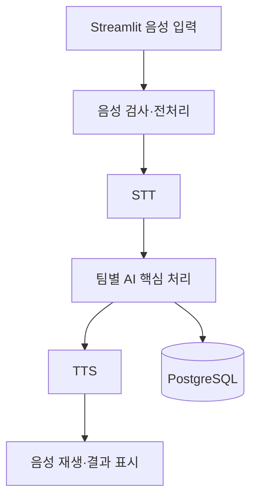

# 시스템 아키텍처 및 화면 설계서

## 1. 전체 데이터 흐름

## 2. 모듈 인터페이스
| 모듈 | 파일명 | 함수명 | 입력 | 반환 | 예외 처리 |
|---|---|---|---|---|---|
| audio | [ ] | [ ] | WAV | 파형·SR | [ ] |
| stt | [ ] | [ ] | 오디오 | 전사문 | [ ] |
| core | [ ] | [ ] | 전사문 | 처리결과 | [ ] |
| tts | [ ] | [ ] | 응답문 | 오디오 | [ ] |
| db | [ ] | [ ] | 결과 | 저장 ID | [ ] |

## 3. 화면별 명세
| 화면 ID | 화면명 | 주요 위젯 | 이벤트 | 성공/실패 표시 |
|---|---|---|---|---|
| UI-01 | 메인 | st.audio_input / st.file_uploader | 음성 제출 | [ ] |
| UI-02 | 결과 | 텍스트·st.audio | 결과 재생 | [ ] |
| UI-03 | 이력 | 표·그래프 | 조회 | [ ] |

## 4. 데이터 흐름·보안
- 음성 원본 저장 정책: [기본 미저장 / 저장 시 동의와 삭제 기준]
- API 키: .env / 배포 환경변수
- 사용자 식별 방식 및 접근통제: [ ]
- 에러 및 로깅 정책: [ ]

## 5. 배포 구조 및 장애 대체 경로
- UI 배포: [ ]
- STT/TTS 추론 위치: [ ]
- DB 위치: [ ]
- 배포 실패 시 로컬 시연 절차: [ ]
