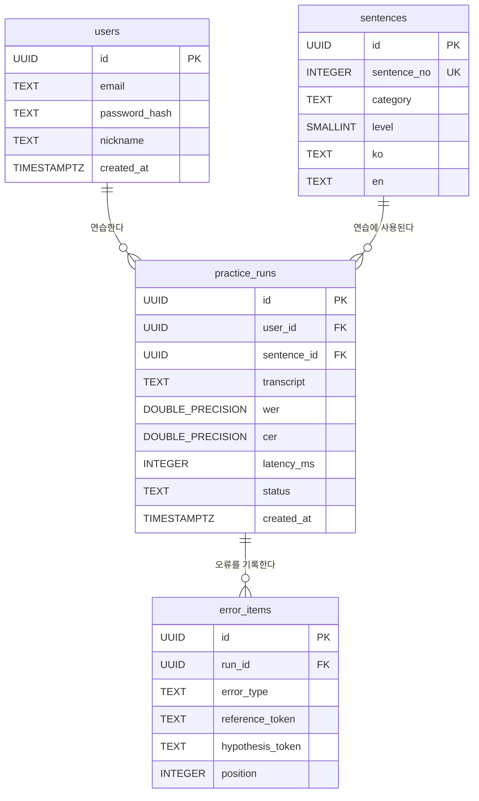
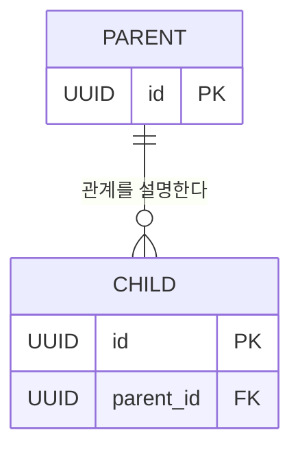

# STT 한국어 학습 서비스 데이터베이스 관계도 (Mermaid ERD)

> **4개 테이블 통합 설계안**입니다. 아직 PostgreSQL에 실제 생성되었다는 의미는 아닙니다. `tourist_sentences`, `tourist_categories`, `sentence_categories`는 별도로 만들지 않습니다. 30개 관광 문장도 `sentences`에 저장합니다.

## 1. 전체 관계도



**관계 이름**은 설명을 위한 단어이고, 실제 연결은 FK 제약조건으로 이루어집니다.

| 부모 테이블(PK) | 자식 테이블(FK) | 관계 | 의미 |
|---|---|---|---|
| `users.id` | `practice_runs.user_id` | 1:N | 한 회원이 0번 이상 연습할 수 있음 |
| `sentences.id` | `practice_runs.sentence_id` | 1:N | 한 문장이 여러 연습에 사용될 수 있음 |
| `practice_runs.id` | `error_items.run_id` | 1:N | 한 연습에서 오류가 0개 이상 기록될 수 있음 |

## 2. 테이블별 역할

### users: 회원가입 및 로그인

- `id` (PK): 회원을 고유하게 식별하는 UUID
- `email`: 로그인용 이메일. `LOWER(email)` 고유 인덱스로 대소문자만 다른 중복 가입 차단
- `password_hash`: 원본 비밀번호 대신 안전하게 해시된 문자열 저장. 비밀번호 해시 생성·검증은 애플리케이션에서 수행
- `nickname`: 사용자 이름
- `created_at`: 가입 시각

### sentences: 한국어 학습 문장 30개

- `id` (PK): 문장 UUID. 다른 테이블에서는 이 값으로 참조
- `sentence_no` (UK): 원본 Python `SENTENCES_DB`의 `id` 값(1~30). `UNIQUE`로 중복 방지
- `category`: `가격/쇼핑`, `이동/길찾기`, `식당/주문`, `숙박/기타` 중 하나를 저장하는 텍스트
- `level`: `SMALLINT` 난이도. 1=쉬움, 2=보통, 3=어려움
- `ko`: STT 평가 기준이 되는 한국어 문장
- `en`: 문장에 대한 영어 번역

**이전 설계에서 변경:** `sentences.text` → `sentences.ko`, 영어 번역 `en`, 문장 번호 `sentence_no` 추가. 관광 문장 테이블과 카테고리 테이블을 별도로 두지 않음.

### practice_runs: 사용자별 STT 연습 결과

- `id` (PK): 연습 기록 UUID
- `user_id` (FK → `users.id`): 누가 연습했는가
- `sentence_id` (FK → `sentences.id`): 어떤 문장을 연습했는가
- `transcript`: STT가 인식한 문장
- `wer`, `cer`: 단어 및 문자 오류율 (예: 0.25 = 25%)
- `latency_ms`: STT 처리시간(밀리초)
- `status`: 성공·오류 등의 처리 상태
- `created_at`: 연습 시각

### error_items: STT 오류 상세 기록

- `id` (PK): 오류 자체의 UUID
- `run_id` (FK → `practice_runs.id`): 어느 연습에서 발생했는가
- `error_type`: `substitution`(대체), `deletion`(삭제), `insertion`(삽입)
- `reference_token`: 정답에 있던 단어·어절
- `hypothesis_token`: 인식된 단어·어절
- `position`: 오류 위치
- `ON DELETE CASCADE`: 연습 기록이 삭제되면 해당 오류 상세 기록도 함께 삭제

## 3. 연결이 실제로 이루어지는 SQL

```sql
-- 회원과 연습 결과
user_id UUID NOT NULL REFERENCES users(id),
-- 문장과 연습 결과
sentence_id UUID NOT NULL REFERENCES sentences(id),
-- 연습 결과와 오류 상세
run_id UUID NOT NULL REFERENCES practice_runs(id) ON DELETE CASCADE
```

`id`는 **현재 테이블의 행을 식별하는 PK**, `user_id`, `sentence_id`, `run_id`는 **다른 테이블의 PK를 가리키는 FK**입니다. `users ||--o{ practice_runs`는 한 회원에게 연습 기록이 0건 이상 연결되는 **1:N** 관계를 뜻합니다.

## 4. SQL 파일별 역할 및 실행 순서

| 순서 | 파일 | 내용 |
|---:|---|---|
| 1 | `01_extension_pgcrypto.sql` | `pgcrypto` 확장 준비 |
| 2 | `02_users.sql` | `users` 생성 |
| 3 | `03_sentences.sql` | `sentences` 생성 (문장·번역·난이도·카테고리 통합) |
| 4 | `04_practice_runs.sql` | `practice_runs` 생성 및 회원·문장 FK 설정 |
| 5 | `05_error_items.sql` | `error_items` 생성 및 연습 기록 FK 설정 |
| 6 | `06_seed_sentences_30.sql` | 관광객 한국어 학습 문장 30개 삽입 |
| 확인용 | `07_check_queries.sql` | 등록 건수 및 테이블 연결 조회 |

`setup_all.sql`은 1~6번 SQL을 순서대로 합친 파일입니다. **새로운 빈 데이터베이스**라면 `setup_all.sql` 한 파일만 실행하면 됩니다. 이미 예전 5개 테이블 구조를 실제로 생성했다면 `CREATE TABLE IF NOT EXISTS`만으로는 기존 테이블 구조가 바뀌지 않습니다. 그때는 별도 마이그레이션 작업이 필요합니다.

## 5. 핵심 Mermaid 문법



- `erDiagram`: Mermaid 데이터베이스 관계도 시작
- `PK`: Primary Key, 기본키
- `FK`: Foreign Key, 외래키
- `UK`: Unique Key, 값 중복을 허용하지 않는 고유 제약 표시
- `||`: 정확히 하나
- `o{`: 0개 이상
- `||--o{`: 왼쪽 하나에 오른쪽 0개 이상의 **1:N** 관계
- `:` 뒤 문자열: 관계 설명 문구. SQL 명령은 아님

## 6. 설계 주의사항

1. 이 설계에서는 **총 4개 테이블만 사용**합니다. `tourist_sentences`나 카테고리 테이블을 별도로 생성하지 않습니다.
2. `practice_runs.sentence_id`는 반드시 `sentences.id`(UUID)를 참조합니다. 화면에 보이는 `sentence_no`(정수 1~30)를 FK에 그대로 넣으면 안 됩니다.
3. `users`가 생성된 이후 `practice_runs`를 만들어야 하며, `practice_runs`를 만든 이후 `error_items`를 만들어야 합니다.
4. 문장 30개는 제공된 예시 데이터이며, 오류율·연습 결과는 연습 시점에 새로 생성됩니다.
5. Mermaid 관계도 자체는 SQL을 실행하지 않습니다. 실제 테이블 생성은 SQL 파일로 해야 합니다.
