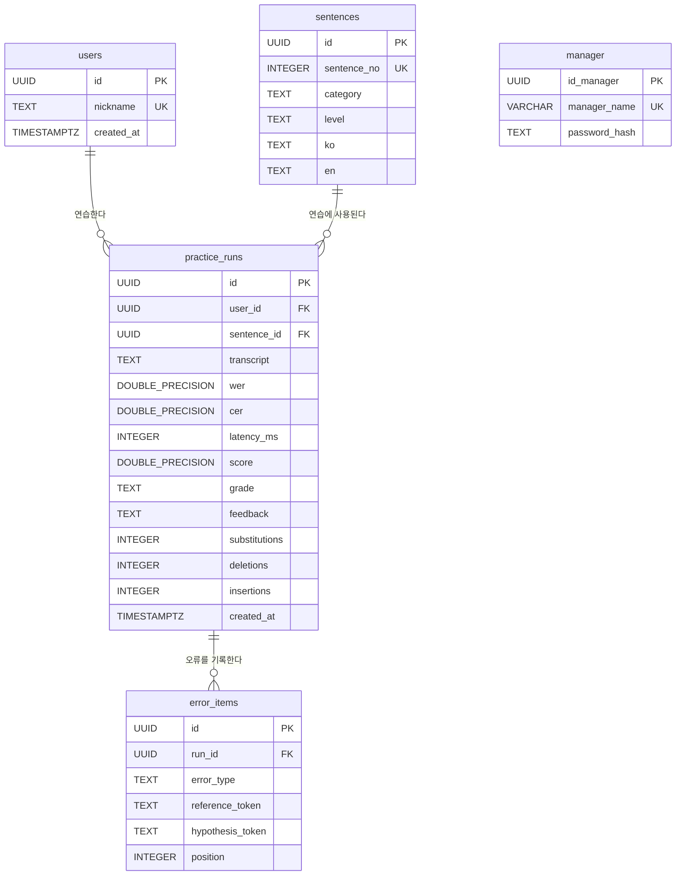
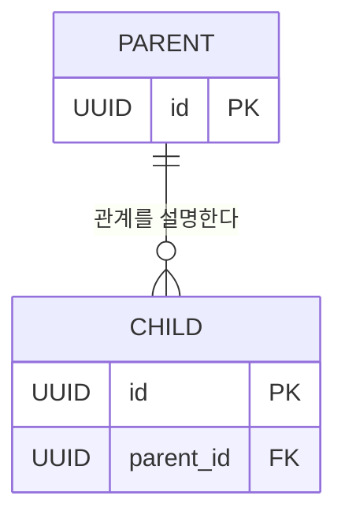
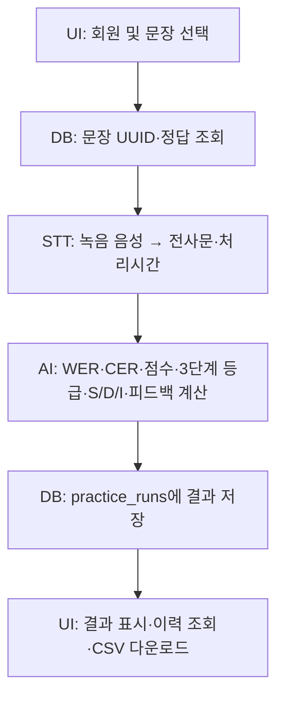
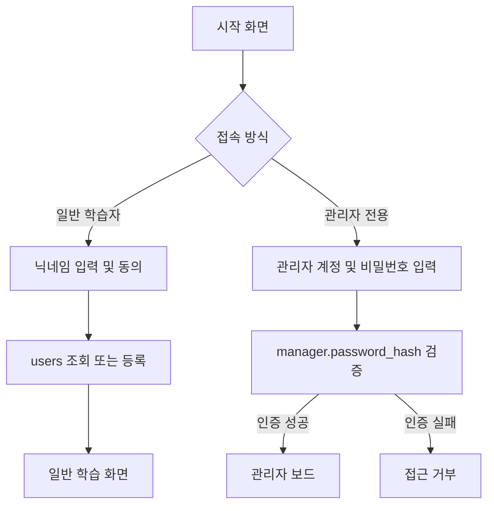

# STT 한국어 학습 서비스 데이터베이스 관계도 (Mermaid ERD)

> **NaraTalk 5개 테이블 통합 설계안 (관리자 테이블 추가)**입니다. 기존 4개 테이블(`users`, `sentences`, `practice_runs`, `error_items`)의 관계를 유지하고, 관리자 인증 정보용 `manager` 테이블을 독립적으로 추가했습니다. 닉네임 기반 회원 관리, 학습 문장 34개, CER 기반 3단계 평가를 반영합니다. `tourist_sentences`, `tourist_categories`, `sentence_categories`는 생성하지 않으며 학습 문장은 모두 `sentences`에 저장합니다.
>
> **현재 상태 구분 (2026-10-27):** Neon에서 `manager` 테이블이 만들어진 것은 사용자가 직접 확인했습니다. 그러나 관리자 계정 1건의 INSERT 성공 여부, 관리자 로그인 Python 함수, 관리자 전용 화면 연동은 아직 이 문서만으로 확인되지 않습니다. 다른 4개 테이블의 설명은 공유된 DB 설계와 코드에 근거하며, 현재 Neon의 모든 제약조건까지 재검증한 것은 아닙니다.

## 1. 전체 관계도



**관계 이름**은 설명을 위한 문구이고, 테이블 간 실제 연결은 외래키(FK) 제약조건으로 이루어집니다.

**`manager`는 다른 4개 테이블과 외래키로 연결되지 않는 독립 테이블**입니다. Mermaid ERD에도 관계선을 추가하지 않았습니다. 관리자는 일반 학습자의 `users` 레코드를 통해 인증하지 않습니다.

| 부모 테이블(PK) | 자식 테이블(FK) | 관계 | 의미 |
|---|---|---|---|
| `users.id` | `practice_runs.user_id` | 1:N | 한 회원이 0회 이상 연습할 수 있음 |
| `sentences.id` | `practice_runs.sentence_id` | 1:N | 한 문장이 여러 연습 기록에 사용될 수 있음 |
| `practice_runs.id` | `error_items.run_id` | 1:N | 한 번의 연습에서 오류 상세를 0건 이상 기록할 수 있음 |
| `manager` | 없음 | 독립 | 관리자는 별도 계정과 비밀번호 해시로 인증 |

## 2. 테이블별 역할

### users: 닉네임 기반 회원 등록·조회

- `id` (PK): 회원을 구분하는 UUID. 기본값은 `gen_random_uuid()`.
- `nickname`: 회원 닉네임. 비어 있는 값은 허용하지 않으며, `LOWER(nickname)` 고유 인덱스로 영문 대소문자만 다른 중복도 차단.
- `created_at`: 등록 시각. `TIMESTAMPTZ` 타입, 기본값 `now()`.

**현재 프로토타입에는 `email`, `password_hash`가 없습니다.** `login_user(nickname)`은 닉네임으로 회원을 조회하는 기능이며, 실제 비밀번호 인증 기능은 아닙니다. Mermaid의 `UK`는 고유한 닉네임을 나타내는 개념적 표기이며, 실제 SQL에서는 `LOWER(nickname)`에 대한 고유 인덱스로 구현합니다.

### sentences: 한국어 학습 문장 34개

- `id` (PK): 문장 UUID. 연습 기록의 `sentence_id`가 참조.
- `sentence_no` (UK): 학습 문장 표시 번호(기본 데이터는 1~34). `UNIQUE`로 중복 방지.
- `category`: 다음 **5개 카테고리** 중 하나를 저장하는 텍스트.
  - `필수 기초 회화`
  - `이동 및 길찾기`
  - `숙박 및 기타`
  - `가격 및 쇼핑`
  - `식당 및 주문`
- `level`: `TEXT` 타입의 문장 난이도. `쉬움`, `보통`, `어려움` 중 하나만 허용.
- `ko`: STT 평가 기준이 되는 한국어 정답 문장.
- `en`: 문장의 영어 번역.

**주의:** `sentences.level`은 **문장 자체의 난이도**이고, `practice_runs.grade`는 **사용자의 평가 등급**입니다. 서로 다른 값이므로 혼동하지 않습니다.

### practice_runs: 사용자별 STT 연습 및 평가 결과

- `id` (PK): 연습 1회를 식별하는 UUID.
- `user_id` (FK → `users.id`): 연습한 회원의 UUID.
- `sentence_id` (FK → `sentences.id`): 연습에 사용한 문장의 UUID.
- `transcript`: STT가 인식한 문장.
- `wer`: 단어 오류율. 예: `0.25`는 25%.
- `cer`: 문자 오류율. 예: `0.15`는 15%.
- `latency_ms`: STT 처리 시간(밀리초). 예: 1.2초 = `1200`ms.
- `score`: AI 평가 점수. `DOUBLE PRECISION`.
- `grade`: CER을 기준으로 한 **3단계 평가 등급**. `매우 우수`, `양호한 수준`, `기초에 집중` 중 하나.
- `feedback`: AI 평가 문구. 한글과 이모지를 포함한 `TEXT` 문자열을 저장할 수 있음.
- `substitutions`: S(Substitution), 정답과 다르게 인식된 **문자 수**.
- `deletions`: D(Deletion), 정답에서 **누락된 문자 수**.
- `insertions`: I(Insertion), 정답에 없는데 **추가된 문자 수**.
- `created_at`: 연습 기록 생성 시각. `TIMESTAMPTZ` 타입, 기본값 `now()`.

**기존 `status BOOLEAN`(합격/불합격)은 제거합니다.** NaraTalk은 합격/불합격 대신 `grade`로 평가 등급을 저장합니다. `score`, `grade`, `feedback`, S·D·I 개수는 AI 평가 함수의 반환값에서 가져옵니다.

#### CER 평가 기준

| CER 범위 | `grade` | `feedback` 예시 |
|---|---|---|
| 0% 이상 ~ 15% 이하 | `매우 우수` | `🌟 완벽해요! 원어민처럼 매우 정확한 발음입니다.` |
| 15% 초과 ~ 45% 이하 | `양호한 수준` | `👍 좋아요! 의사소통에 문제없지만 일부 음절을 더 명확히 해보세요.` |
| 45% 초과 | `기초에 집중` | `🔄 기초부터 다시 차근차근 읽어볼까요?` |

이 평가는 **STT 인식 결과의 문자 오류율을 이용한 평가**입니다. 실제 사람의 발음 품질을 직접 측정하는 전문 음성학적 평가와 동일하다고 해석해서는 안 됩니다.

### error_items: STT 오류 개별 상세 기록

- `id` (PK): 개별 오류의 UUID.
- `run_id` (FK → `practice_runs.id`): 어느 연습에서 발생했는지 연결.
- `error_type`: `substitution`(대체), `deletion`(삭제), `insertion`(삽입).
- `reference_token`: 정답에서 대응되는 문자·단어·어절.
- `hypothesis_token`: STT 결과에서 대응되는 문자·단어·어절.
- `position`: 오류 발생 위치(정수). **0부터 셀지 등은 AI·UI 담당과 통일**해야 함.
- `ON DELETE CASCADE`: 연습 기록 삭제 시 해당 오류 상세 기록도 함께 삭제.

**두 테이블의 차이:** `practice_runs.substitutions/deletions/insertions`는 **오류 전체 개수**, `error_items`는 **각 오류의 원문·인식값·위치**를 저장합니다. 현재 AI 코드에서는 글자 오류 *개수*가 반환되며, 개별 오류 데이터는 별도 추출 기능이 있어야 저장할 수 있습니다.

### manager: 관리자 전용 인증 정보

- `id_manager` (PK): 관리자를 구분하는 UUID. 기본값은 `gen_random_uuid()`.
- `manager_name` (UK): 관리자의 계정 이름. 현재 생성 SQL 기준으로 `VARCHAR(50) NOT NULL UNIQUE`.
- `password_hash`: 관리자가 입력하는 비밀번호의 **bcrypt 해시값**. `TEXT NOT NULL`로 저장하며 원문 비밀번호는 저장하지 않음.

**`users`와의 차이:** `users.nickname`은 학습자를 찾기 위한 닉네임이고 인증 비밀번호가 아닙니다. `manager.manager_name`은 관리자 계정 이름이며, 관리자 로그인에서는 입력한 비밀번호를 `password_hash`와 검증해야 합니다.

**현재 확인된 상태:** 사용자는 Neon에서 `public.manager` 테이블 및 세 컬럼이 존재함을 확인했습니다. 실제로 관리자 계정 행이 저장되었는지는 아래 조회로 확인해야 합니다.

```sql
SELECT id_manager, manager_name
FROM public.manager;
```

`0행`이면 테이블만 만들어진 것이므로 계정 등록이 필요합니다. 비밀번호 원문 또는 해시값을 화면이나 문서에 노출하지 않습니다.

## 3. 연결이 실제로 이루어지는 SQL

다음은 각 `CREATE TABLE` 구문에 들어가는 외래키 정의의 예시입니다. 각각 해당 테이블 안에서 선언합니다.

```sql
-- practice_runs 테이블: 회원과 연습 결과 연결
user_id UUID NOT NULL REFERENCES users(id),

-- practice_runs 테이블: 학습 문장과 연습 결과 연결
sentence_id UUID NOT NULL REFERENCES sentences(id),

-- error_items 테이블: 연습 기록과 상세 오류 연결
run_id UUID NOT NULL REFERENCES practice_runs(id) ON DELETE CASCADE
```

`id`는 **현재 테이블의 행을 식별하는 PK(기본키)**이고, `user_id`, `sentence_id`, `run_id`는 **다른 테이블의 PK를 참조하는 FK(외래키)**입니다. `users ||--o{ practice_runs`는 회원 1명에게 연습 기록이 0건 이상 연결되는 **1:N 관계**를 뜻합니다.

### practice_runs 핵심 테이블 생성 SQL

```sql
CREATE TABLE IF NOT EXISTS practice_runs (
    id UUID PRIMARY KEY DEFAULT gen_random_uuid(),
    user_id UUID NOT NULL REFERENCES users(id),
    sentence_id UUID NOT NULL REFERENCES sentences(id),
    transcript TEXT,
    wer DOUBLE PRECISION,
    cer DOUBLE PRECISION,
    latency_ms INTEGER,
    score DOUBLE PRECISION,
    grade TEXT CHECK (grade IN ('매우 우수', '양호한 수준', '기초에 집중')),
    feedback TEXT,
    substitutions INTEGER CHECK (substitutions >= 0),
    deletions INTEGER CHECK (deletions >= 0),
    insertions INTEGER CHECK (insertions >= 0),
    created_at TIMESTAMPTZ NOT NULL DEFAULT now()
);

CREATE INDEX IF NOT EXISTS idx_practice_runs_user_id ON practice_runs (user_id);
CREATE INDEX IF NOT EXISTS idx_practice_runs_sentence_id ON practice_runs (sentence_id);
```

`CHECK`는 허용되지 않는 값을 저장하지 못하도록 제한합니다. 예를 들어 `grade='실패'` 또는 `deletions=-1`은 위 제약조건을 만족하지 않습니다.

### manager 테이블 생성 SQL (현재 추가된 테이블)

```sql
CREATE TABLE IF NOT EXISTS public.manager (
    id_manager UUID PRIMARY KEY DEFAULT gen_random_uuid(),
    manager_name VARCHAR(50) NOT NULL UNIQUE,
    password_hash TEXT NOT NULL
);
```

이 SQL은 **테이블 구조만 생성**하며 관리자 계정을 자동으로 등록하지 않습니다. 실제 테이블이 이미 있다면 다시 실행할 필요가 없습니다.

### 관리자 계정 한 건 등록 (필요한 경우에만)

```sql
CREATE EXTENSION IF NOT EXISTS pgcrypto;

INSERT INTO public.manager (manager_name, password_hash)
VALUES (
    '관리자',
    crypt('새로_정한_관리자_비밀번호', gen_salt('bf'))
)
ON CONFLICT (manager_name) DO NOTHING;
```

- `gen_salt('bf')`: bcrypt 해시에 사용할 무작위 솔트를 생성합니다.
- `crypt()`: 입력한 비밀번호를 솔트와 함께 해시 처리합니다.
- `ON CONFLICT ... DO NOTHING`: 같은 `manager_name`이 이미 있으면 중복 삽입하지 않습니다. **기존 계정의 비밀번호를 갱신하지 않습니다.**

**주의:** 위 비밀번호는 자리표시자이므로 실제 사용 시 새로 정한 강력한 비밀번호로 변경해야 합니다. DBeaver의 쿼리 기록에 비밀번호 원문이 남을 수 있어 운영 환경에서는 애플리케이션 또는 별도의 안전한 초기 등록 절차를 권장합니다. 기존에 대화에서 공개한 숫자형 마스터키는 사용하지 않습니다.

## 4. SQL 파일별 역할 및 실행 순서

기존 4개 학습 테이블의 SQL 파일은 프로젝트 최상위 `sql_schema_sql/`에 있습니다. **최근 프로젝트 실행 경로는 `src/db.py`와 `src/.env`**로 확인되므로, 기존 문서의 `src_db/db.py`·`src_db/.env` 표기는 현재 구조에 맞게 정정했습니다.

| 권장 순서 | 파일 | 내용 | 확인 수준 |
|---:|---|---|---|
| 1 | `extension_pgcrypto.sql` | 확장 기능 준비 | 기존 SQL 파일 |
| 2 | `create_users.sql` | `users` 생성 | 기존 SQL 파일 |
| 3 | `create_sentences.sql` | `sentences` 생성 | 기존 SQL 파일 |
| 4 | `create_practice_runs.sql` | 3단계 평가 결과 저장 테이블 생성 | 기존 SQL 파일 |
| 5 | `create_error_items.sql` | 상세 오류 및 FK 생성 | 기존 SQL 파일 |
| 6 | `seed_sentences_34.sql` | 기본 문장 34개 삽입 또는 갱신 | 기존 SQL 파일 |
| 별도 | `create_manager.sql` **(추가 예정)** | `manager` 생성 | **현재는 Neon/DBeaver에서 수동 생성된 것으로 확인** |
| 별도 | `login_manager.sql` **(추가 예정)** | 관리자 비밀번호 검증 | **아직 기존 코드에 있는지 확인되지 않음** |
| 확인용 | `check_queries.sql` | 기존 테이블 및 기록 조회 | 기존 SQL 파일 |

`manager`는 기존 4개 테이블에 외래키로 종속되지 않으므로 독립적으로 생성할 수 있습니다. 팀원이 동일한 DB를 초기화해야 한다면 방금 사용한 관리자 테이블 생성 SQL을 `sql_schema_sql/create_manager.sql`로 추가하고, `src/db.py`의 초기화 함수가 실제로 존재한다면 실행 목록에 등록하는 작업이 필요합니다. **현재 `initialize_database()`가 관리자 테이블까지 생성한다고 가정하면 안 됩니다.**

이미 테이블이 존재한다면 `CREATE TABLE IF NOT EXISTS`만으로 컬럼 구조가 갱신되지 않습니다. 기존 `practice_runs`가 `status` 기반 구버전이라면 데이터 백업 후 필요한 `ALTER TABLE` 마이그레이션을 해야 합니다.

`save_practice_run.sql`, `get_practice_history.sql`과 `src/db.py`의 반환 항목이 실제 테이블과 일치하는지도 확인해야 합니다. `update_practice_status()` 등 구버전 `status` 관련 호출은 사용하지 않도록 정리합니다.

## 5. 핵심 Mermaid 문법



- `erDiagram`: Mermaid 데이터베이스 관계도 시작.
- `PK`: Primary Key, 기본키.
- `FK`: Foreign Key, 외래키.
- `UK`: Unique Key, 값 중복을 허용하지 않는 고유 조건 표시.
- `||`: 정확히 하나.
- `o{`: 0개 이상.
- `||--o{`: 왼쪽 하나에 오른쪽 0개 이상의 **1:N 관계**.
- `:` 뒤 문자열: 관계에 대한 설명 문구. SQL 명령은 아님.

## 6. 설계 주의사항

1. **총 5개 테이블**(`users`, `sentences`, `practice_runs`, `error_items`, `manager`)을 기준으로 합니다. 관광 문장·카테고리 테이블은 별도 생성하지 않습니다.
2. `practice_runs.sentence_id`는 `sentences.id`의 **UUID**를 참조합니다. 화면 번호인 `sentence_no`(정수 1~34)를 FK 자리에 넣으면 안 됩니다.
3. `users`와 `sentences`를 생성한 후 `practice_runs`를, 그다음 `error_items`를 생성합니다.
4. 초기 문장은 **34개·5개 카테고리**이며, 연습 결과와 오류 수는 사용자가 연습할 때마다 새로 생성됩니다.
5. `sentences.level`은 **문장 난이도**(쉬움/보통/어려움), `practice_runs.grade`는 **평가 등급**(매우 우수/양호한 수준/기초에 집중)입니다.
6. 이전 합격/불합격용 `status`는 사용하지 않습니다. 기존 호출 코드에 `status`가 남아 있으면 저장 오류가 발생할 수 있습니다.
7. `feedback`은 **이모지를 포함한 `TEXT`**로 저장할 수 있습니다. PostgreSQL 인코딩은 UTF-8을 사용하고, 추후 CSV를 Windows Excel에서 열기 쉽게 내보낼 때는 UI 쪽에서 `utf-8-sig`로 변환할 수 있습니다.
8. `practice_runs`의 S·D·I는 **문자별 오류 개수**입니다. `error_items`에 상세 오류를 기록하려면 AI 평가 모듈이 개별 오류의 문자·위치도 제공해야 합니다.
9. `seed_sentences_34.sql`은 동일 `sentence_no`가 이미 있을 때 내용을 갱신할 수 있으므로, 앱을 시작할 때마다 초기화를 반복하지 않습니다.
10. `manager`는 학습 기록과 FK로 연결하지 않습니다. 관리자 페이지에서 회원 정보를 볼 때는 별도로 `users`를 조회합니다.
11. 관리자 비밀번호는 `manager.password_hash`에 해시 형태로 저장합니다. **관리자 이름 또는 회원 닉네임만 일치한다고 관리자로 인증하면 안 됩니다.**
12. 사용자용 사이드바에서 관리자 메뉴를 숨기는 것만으로는 권한 검사가 되지 않습니다. 관리자 화면 진입과 관리자 전용 데이터 작업 모두 인증 상태를 검사해야 합니다.
13. Mermaid 관계도는 SQL을 실행하지 않습니다. `manager` 테이블의 존재는 Neon에서 확인되었으나, 관리자 계정 등록과 관리자 로그인 성공은 별도 검증이 필요합니다.

## 7. 평가 결과가 저장되는 흐름



현재 DB의 `save_practice_run()`은 AI 평가가 끝난 후 전달된 값을 저장하는 역할입니다. STT·TTS 모델을 DB에서 직접 호출하지 않으며, 서비스 연결 코드 또는 UI가 각 모듈의 반환값을 모아 DB 함수를 호출합니다.

### 관리자 로그인 흐름 (설계, UI/DB 함수 연동은 별도 작업)



- 일반 회원 로그인과 관리자 인증은 서로 독립적인 흐름입니다.
- **닉네임 입력값을 관리자 마스터키와 비교해 우회 로그인하는 방식은 사용하지 않습니다.**
- 관리자 인증 성공 시에만 세션에 관리자 여부를 표시합니다. 세션 상태만 믿지 않고 관리자 전용 DB 작업에서도 권한 확인이 필요합니다.
- 비밀번호 검증용 SQL은 Python에서 매개변수를 바인딩하는 형태를 사용할 수 있습니다.

```sql
SELECT id_manager, manager_name
FROM public.manager
WHERE manager_name = %s
  AND password_hash = crypt(%s, password_hash);
```

위 `%s`는 `psycopg`가 전달하는 매개변수 자리이므로 **DBeaver에 그대로 실행하는 완성 SQL은 아닙니다.**

**최종 변경 요약**

| 구분 | 반영 내용 |
|---|---|
| 유지 | `users`, `sentences`, `practice_runs`, `error_items`의 기존 학습 데이터 관계 및 FK |
| 삭제 | `practice_runs.status`, 합격/불합격 표시용 `status_label`, `update_practice_status()` 및 관련 SQL |
| 추가 | 기존 3단계 평가용 `practice_runs` 컬럼과 독립 `manager(id_manager, manager_name, password_hash)` 테이블 |
| 변경 | 회원은 닉네임 기반, 문장은 34개·5카테고리, `level`은 문자열, 평가 결과는 CER 기반 3단계 |
| 적용 확인 | Neon에서 `manager` 테이블과 컬럼 존재 확인. 관리자 계정 INSERT 성공 여부는 별도 조회 필요 |
| 연동 예정 | 관리자 계정 인증 함수, 시작 화면의 관리자 로그인, 관리자 보드 접근 제어, SQL 파일 관리 |
| 경로 정정 | 현재 코드 구조 기준 `src/db.py`, `src/.env` 사용. 기존 문서의 `src_db`는 구버전 경로 |
