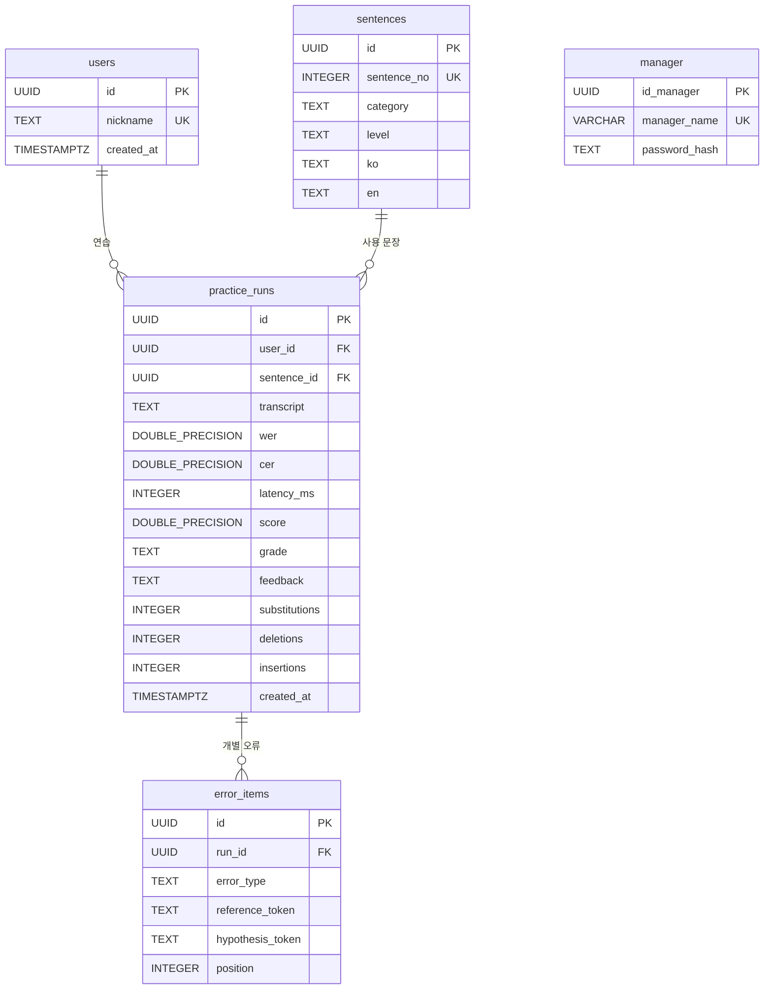

# NaraTalk 데이터베이스 관계와 관리자 조회 설계
## 1. 전체 관계도



관리자 계정은 독립적인 `manager` 테이블에 저장하며 `users`와 연결하지 않는다. 따라서 `users`의 전체 사용자 수에는 관리자 계정이 포함되지 않는다. `PK`는 기본키, `FK`는 외래키, `UK`는 고유 값이라는 뜻이다. `users.nickname`은 컬럼의 `UNIQUE`가 아니라 `LOWER(nickname)` 고유 인덱스로 중복을 방지한다.

| 연결 키 | 관계 | 의미 |
|---|---|---|
| `practice_runs.user_id → users.id` | 회원 1명 : 연습 0건 이상 | 연습한 학습자 |
| `practice_runs.sentence_id → sentences.id` | 문장 1개 : 연습 0건 이상 | 연습한 문장 |
| `error_items.run_id → practice_runs.id` | 연습 1건 : 오류 0건 이상 | 해당 연습의 개별 오류 |

연습 기록을 삭제하면 참조하는 `error_items`는 `ON DELETE CASCADE`로 함께 삭제된다. 현재 `delete_user()`는 회원의 연습 기록을 먼저 삭제한 뒤 회원을 삭제한다. 연습 기록이 남은 문장은 `delete_sentence()`가 삭제를 거부한다.

## 2. 테이블별 역할

### `users`: 일반 학습자

`id`는 내부 UUID, `nickname`은 화면에 보이는 닉네임, `created_at`은 등록 시각이다. 현재 학습자 로그인은 닉네임으로 사용자를 찾으며 비밀번호 인증은 없다. 관리자 계정은 이 테이블에 저장하지 않는다.

### `sentences`: 학습 문장

`id`는 연습 기록이 참조하는 UUID이고 `sentence_no`는 화면에 표시하는 번호다. 기본 데이터는 34문장이다. `category`는 `필수 기초 회화`, `이동 및 길찾기`, `숙박 및 기타`, `가격 및 쇼핑`, `식당 및 주문`의 5종류이며, `level`은 `쉬움`, `보통`, `어려움`이다. `ko`는 한국어 정답, `en`은 영어 번역이다. 화면 번호인 `sentence_no`를 `practice_runs.sentence_id`에 넣으면 안 된다.

### `practice_runs`: 연습과 평가 결과

한 행이 저장된 연습 한 번이다. `user_id`와 `sentence_id`로 학습자와 문장을 연결한다. `transcript`는 STT 인식문, `wer`와 `cer`는 단어 및 글자 오류율, `latency_ms`는 처리 시간이다. `score`, `grade`, `feedback`은 평가 결과이며 `substitutions`, `deletions`, `insertions`는 대치·삭제·삽입 **글자 수**다. `created_at`은 연습 시각이다. 예전 합격/불합격용 `status`는 현재 생성 SQL에 없다.

현재 `src/core.py`는 정답과 STT 인식문을 정규화한 뒤 CER에 따라 등급을 정한다.

| CER | `grade` |
|---:|---|
| 0~0.15 | 매우 우수 |
| 0.15 초과~0.45 | 양호한 수준 |
| 0.45 초과 | 기초에 집중 |

점수는 `max(0, round((1 - CER) × 100, 1))`로 계산한다. 이는 정답과 인식문의 일치도를 바탕으로 한 평가이지 음성학적 발음 품질을 직접 측정한 값은 아니다. `sentences.level`은 **문장 난이도**, `practice_runs.grade`는 **연습 평가 등급**이다.

### `error_items`: 개별 글자 오류

`run_id`는 `practice_runs.id`를 참조한다. `error_type`은 `substitution`(대치), `deletion`(삭제), `insertion`(삽입)이다. `reference_token`은 정답 글자, `hypothesis_token`은 STT 인식 글자다. 삭제의 인식 글자와 삽입의 정답 글자는 `NULL`일 수 있다. `position`은 정규화하고 **공백을 제거한 정답 문자열에서 1부터 세는 위치**다. 음성 재생 시점이나 원문의 공백·구두점 위치가 아니다.

현재 `src/core.py`는 글자 정렬로 개별 오류 목록을 만들고, `app/apps/app_practice.py`는 연습 결과 저장 후 `save_error_items(run_id, ...)`로 상세 오류를 저장하도록 연결되어 있다. 두 저장 호출은 별도 트랜잭션이므로 상세 오류 저장이 실패해도 연습 기록이 남을 수 있다. 따라서 S/D/I 총수와 실제 상세 오류 행 수가 항상 일치한다고 단정할 수 없다.

### `manager`: 관리자 계정

관리자는 `id_manager`, `manager_name`, `password_hash`를 가진 별도 테이블에서 인증한다. 제공된 대화에서는 Neon에 이 테이블과 컬럼이 있다고 확인했지만, 원본 ZIP에는 `create_manager.sql`이 없다. 원본의 `login_manager.sql`과 `login_manager(password)`는 **관리자 이름 없이 비밀번호만 검사하여 첫 일치 계정을 반환**한다. 이름과 비밀번호를 함께 확인하는 화면을 만들려면 화면 입력, 함수 인자와 SQL 조건을 함께 수정해야 한다. 실제 계정 등록과 로그인 성공 여부는 별도 확인이 필요하다.

## 3. 관리자 통계: SQL 5개

아래 5개 SQL과 대응하는 함수는 **별도 관리자 화면 수정본**에서 작성했다. 제공된 `NaraTalk10_28.zip` 원본의 `sql_schema_sql/`과 `src/db.py`에는 아직 합쳐져 있지 않다.

| SQL 파일 / DB 함수 | 반환 정보 | 화면 항목 |
|---|---|---|
| `get_count_users.sql` / `get_count_users()` | `total_users` | 전체 등록 학습자 수 |
| `get_nickname_cteated_at.sql` / `get_nickname_cteated_at()` | `nickname`, `created_at`, `practice_count` | 닉네임·등록일·회원별 연습 횟수 |
| `get_category_top5.sql` / `get_category_top5()` | `category`, `practice_count` | 카테고리 TOP 5 |
| `get_level_top5.sql` / `get_level_top5()` | `level`, `practice_count` | 난이도 TOP 3 |
| `get_sentence_top5.sql` / `get_sentence_top5()` | `sentence_id`, `sentence_no`, `category`, `level`, `ko`, `practice_count` | 문장 TOP 5 |

`cteated`는 기존에 정한 **파일명과 함수명의 철자**를 유지한 것이다. 실제 DB 컬럼은 `created_at`이다. `get_level_top5.sql`이라는 파일명도 유지하지만 내용은 `LIMIT 3`이다.

TOP은 전체 학습자의 전체 기간 `practice_runs`를 대상으로 **저장된 기록 1건을 연습 1회**로 센다. 같은 사람이 같은 문장을 세 번 연습하면 세 번으로 집계한다. 연습이 없는 항목은 TOP에 나타나지 않는다. SQL이 연습 횟수순으로 반환하고 화면은 결과에 1부터 순위 번호를 붙인다. 동률에도 별도 번호를 붙이며 보조 정렬 기준은 카테고리 이름, 난이도 `쉬움 → 보통 → 어려움`, 문장 번호 순이다. 회원 목록은 `LEFT JOIN`을 사용해 연습하지 않은 회원도 0회로 보여준다.

별도 수정본의 관리자 화면은 총 연습 횟수와 평균 점수도 표시한다. 이 두 값은 화면 코드에서 `practice_runs`를 직접 조회한다. “전처리 전후 비교”는 저장된 STT **텍스트** 정규화 전후이며 음성 잡음 제거 전후 비교가 아니다.

## 4. 연습 오류 조회

원본에는 한 연습 기록의 오류를 가져오는 `get_error_items.sql`과 `get_error_items(run_id)`가 이미 있다.

```sql
-- sql_schema_sql/get_error_items.sql
SELECT id, error_type, reference_token, hypothesis_token, position
FROM error_items
WHERE run_id = %s
ORDER BY position NULLS LAST, id;
```

`run_id`에는 `practice_runs.id`를 전달한다. 한 행이 개별 오류 한 건이다. 결과가 `[]`라면 오류가 없었거나 상세 오류가 저장되지 않았을 수 있다.

관리자가 **전체 학습자의 최근 오류**를 보려면 아래 파일과 함수를 추가한다. 앞선 대화에서 제안했으나 아직 원본 ZIP과 관리자 통계 수정본에는 포함되지 않은 조회다.

```sql
-- sql_schema_sql/get_recent_errors.sql
SELECT p.id AS run_id,
       p.created_at AS practiced_at,
       u.nickname,
       s.sentence_no,
       s.ko,
       s.en,
       p.transcript,
       e.error_type,
       e.reference_token,
       e.hypothesis_token,
       e.position
FROM error_items AS e
JOIN practice_runs AS p ON e.run_id = p.id
JOIN users AS u ON p.user_id = u.id
JOIN sentences AS s ON p.sentence_id = s.id
ORDER BY p.created_at DESC, p.id DESC, e.position NULLS LAST, e.id
LIMIT 100;
```

```python
# src/db.py의 if __name__ == '__main__': 바로 위에 추가
def get_recent_errors():
    """전체 학습자의 최근 개별 STT 오류를 최대 100건 조회한다."""
    with get_connection() as conn:
        with conn.cursor() as cursor:
            cursor.execute(load_sql('get_recent_errors.sql'))
            return cursor.fetchall()
```

`JOIN error_items`를 사용하므로 상세 오류가 없는 연습은 결과에 없다. `LIMIT 100`은 연습 100회가 아니라 **개별 오류 100건**이다. `s.ko`는 조회 시점의 문장이므로 평가 이후 문장을 수정했다면 당시 정답과 달라질 수 있다. 이 함수의 결과를 관리자 화면에 표시하려면 화면 코드를 추가해야 한다.

한 연습의 오류와 함께 닉네임·정답·인식문을 보여주는 `get_practice_error_details.sql` 및 함수도 별도 수정본에 작성되어 있지만 원본 ZIP에는 없다. 한 연습 상세가 목적이면 그 수정본을, 전체 최근 목록이 목적이면 위 함수를 적용한다.

## 5. 적용 상태와 파일 경로

| 항목 | 10월 28일 원본 ZIP | 이후 작업 |
|---|---|---|
| 네 학습 테이블 및 기본 문장 | 생성 SQL과 `initialize_database()`에 있음 | 실제 DB 반영 여부 확인 |
| 관리자 테이블과 로그인 | 생성 SQL은 없음; 로그인 SQL·함수는 있음 | Neon 테이블 존재는 공유됨; 계정·로그인 확인 필요 |
| 통계 SQL 5개와 함수 5개 | 원본에는 없음 | 별도 수정본의 SQL·함수·화면 적용 필요 |
| 한 연습의 오류 목록 | `get_error_items.sql`과 함수가 있음 | `run_id`로 조회 가능 |
| 전체 최근 오류 목록 | 원본에는 없음 | 위 SQL·함수와 화면 연결 추가 필요 |

원본 `initialize_database()`의 실행 순서는 `extension_pgcrypto.sql → create_users.sql → create_sentences.sql → create_practice_runs.sql → create_error_items.sql → seed_sentences_34.sql`이다. 관리자 테이블은 이 목록에 없다. `CREATE TABLE IF NOT EXISTS`만으로 기존 테이블 컬럼은 갱신되지 않고, 초기 문장 시드는 기존 내용을 갱신할 수 있으므로 재실행 전 DB 상태를 확인한다.

`src/db.py`의 `get_connection()`은 `src/.env`의 `DATABASE_URL`로 연결하고 결과를 딕셔너리 행으로 받는다. `load_sql()`은 프로젝트 루트의 `sql_schema_sql/`에서 SQL 파일을 읽는다. 사용자 수는 `fetchone()`으로 한 행의 값을 가져오고 TOP 및 오류 목록은 `fetchall()`로 여러 행을 가져온다.

## 6. 관리자 화면 요구사항

1. 전체 등록 학습자 수와 닉네임·등록일·연습 횟수 목록을 표시한다.
2. 전체 기간의 연습 기록을 기준으로 카테고리 TOP 5, 난이도 TOP 3, 문장 TOP 5에 순위·이름·연습 횟수를 표시한다.
3. 개별 오류는 `run_id`로 조회하고, 전체 최근 오류를 보여주려면 `get_recent_errors.sql`과 함수를 추가한다.
4. 관리자 인증을 학습자 닉네임 조회와 분리한다. 현재 관리자 로그인 SQL이 비밀번호만 검사한다는 점을 반영해 인증과 화면 접근을 점검한다.

**검증 범위:** 제공된 ZIP과 별도 수정본의 파일 내용을 대조했다. 이 문서 작업 중 Neon 연결 및 통합 Streamlit 실행은 하지 않았다.
